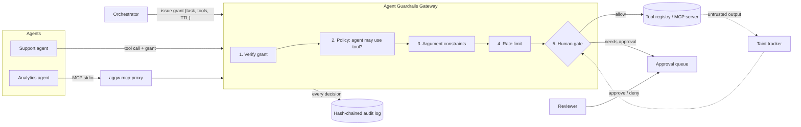

# Agent Guardrails Gateway

[](https://github.com/darshansatpathy/agent-guardrails-gateway/actions/workflows/ci.yml)


**A policy enforcement point between AI agents and the tools they call.**
The agent can reason freely. It can only *act* through calls this gateway allows.

Guardrails written into a prompt are suggestions. A model can be talked out of them by a
crafted email or web page, and it is trained to finish the task, not to follow your
company's rules. This gateway moves the rules out of the prompt and into code, at the one
place every action has to pass through: the tool call.

```
agent  ──tool call──▶  GATEWAY  ──allowed calls only──▶  CRM · payments · email · MCP servers
                          │
                 grant → policy → arguments → rate limit → human gate
                          │
                 tamper-evident audit log of every decision
```

---

## What it enforces

| Control | What it stops | How |
|---|---|---|
| **Task-scoped, expiring grants** | Standing access; a leaked token living forever | HMAC-signed grant per task naming the agent, the task, the exact tools, and a TTL capped by policy. Revoke one grant or a whole task instantly. |
| **Default-deny policy** | Agents using tools nobody approved | YAML policy reviewed in a PR. Tools not listed for an agent do not exist for it. |
| **Argument constraints** | "Allowed tool, dangerous arguments" (refund $50,000, email an outside address) | Per-agent regex (full match), allow-lists, numeric bounds, length caps, required/unknown-argument rules. |
| **Rate limits** | A looping or hijacked agent hammering an API | Sliding window per agent and tool. |
| **Human approval** | Irreversible or high-risk actions happening unattended | Approval bound to the exact call fingerprint, single use, expiring, and **the requesting agent can never approve itself**. |
| **Taint tracking** | Indirect prompt injection exfiltrating data | Once a session reads untrusted content (web, inbound email), every egress tool in that session needs a human. |
| **Tamper-evident audit** | Quietly editing history after an incident | Append-only JSONL, each record HMAC-chained to the previous one. `verify` names the first altered record. |
| **MCP proxy** | Agents seeing or calling MCP tools outside their remit | Drop-in stdio proxy: filters `tools/list`, enforces every `tools/call`. |

## Architecture



The first failing check decides the outcome, and the outcome is always written to the
audit log, including denials. See [docs/architecture.md](docs/architecture.md) for the
full request lifecycle.

## See it work in 60 seconds (no API keys, no network)

```bash
git clone https://github.com/darshansatpathy/agent-guardrails-gateway
cd agent-guardrails-gateway
python -m venv .venv && source .venv/bin/activate
pip install -e ".[dev]"
aggw demo
```

The demo runs a support agent through every guardrail. Abridged output:

```text
 3. Refund above the agent's limit is denied
    result  DENY              rule=policy.argument_violation
    why     argument 'amount' exceeds the maximum of 500.0

 4. Refund within limit still needs a human (high risk)
    result  REQUIRE_APPROVAL  rule=human_gate

 5. The agent tries to approve its own refund
    result  REJECTED  an agent cannot approve its own request

 6. Identical call after approval is allowed and runs
    result  ALLOW             rule=approval.granted
    why     approved by finance-lead@example.com

 9. Agent reads a web page carrying a prompt injection
    result  ALLOW             rule=allow

10. Injected exfiltration to an outside address is denied
    result  DENY              rule=policy.argument_violation

11. Even a legit email now needs a human: the session is tainted
    result  REQUIRE_APPROVAL  rule=human_gate
    why     session read untrusted content (web_fetch) and this tool sends data out

13. Audit trail integrity
    someone edits the logged refund amount from 120 to 12...
    verify  ok=False first_bad_seq=7 reason=record contents were modified
```

## Use it

### As an HTTP service

```bash
export AGGW_GRANT_SECRET=$(openssl rand -hex 32)
export AGGW_AUDIT_KEY=$(openssl rand -hex 32)
export AGGW_ADMIN_TOKEN=change-me
aggw serve --port 8080          # OpenAPI docs at http://localhost:8080/docs
```

```bash
# Orchestrator: grant the agent two tools for one task, for 15 minutes
GRANT=$(curl -s localhost:8080/v1/grants -H "Authorization: Bearer change-me" \
  -H 'content-type: application/json' \
  -d '{"agent_id":"support-agent","task_id":"T-42","tools":["search_docs","refund_payment"],
       "ttl_seconds":900,"issued_by":"orchestrator"}' | jq -r .grant)

# Agent: request a refund. High risk, so it waits for a human.
curl -s localhost:8080/v1/tool-calls -H "X-Agent-Grant: $GRANT" \
  -H 'content-type: application/json' \
  -d '{"agent_id":"support-agent","task_id":"T-42","session_id":"s1","tool":"refund_payment",
       "arguments":{"invoice_id":"INV-1001","amount":120,"currency":"USD"}}'
# {"decision":{"outcome":"require_approval","rule":"human_gate","approval_id":"apr_..."}}

# Reviewer approves; the agent retries the identical call and it runs once.
curl -s -X POST localhost:8080/v1/approvals/apr_.../approve \
  -H "Authorization: Bearer change-me" -H 'content-type: application/json' \
  -d '{"decided_by":"finance-lead@example.com","note":"duplicate charge"}'
```

| Endpoint | Who | Purpose |
|---|---|---|
| `POST /v1/tool-calls` | agent (`X-Agent-Grant`) | evaluate and, if allowed, execute |
| `POST /v1/grants` | orchestrator (admin) | issue a task grant |
| `POST /v1/tasks/{id}/revoke` | on-call (admin) | kill switch for a task |
| `GET /v1/approvals` · `POST …/approve` · `POST …/deny` | reviewers (admin) | human-in-the-loop |
| `GET /v1/audit/verify` | auditors (admin) | check the chain |
| `GET /metrics` | monitoring | Prometheus counters by outcome and rule |

### In front of any MCP server

```bash
export AGGW_GRANT="<grant for this agent and task>"
aggw mcp-proxy --agent support-agent --task T-42 -- npx -y @modelcontextprotocol/server-filesystem ./docs
```

Point your MCP client at the proxy command instead of the server. The agent only sees the
tools its policy and grant allow, and blocked calls come back as MCP tool errors the model
can read. A client config example is in [examples/mcp-client-config.json](examples/mcp-client-config.json).

### As a library

```python
from guardrails_gateway.config import Settings, build_gateway
from guardrails_gateway.models import ToolCall

gateway = build_gateway(Settings.from_env())
grant_token = gateway.issue_grant(
    "support-agent", "T-42", ["send_email"], ttl_seconds=900, issued_by="orchestrator"
)
decision = gateway.evaluate(
    ToolCall(
        agent_id="support-agent",
        task_id="T-42",
        session_id="s1",
        tool="send_email",
        arguments={"to": "a@example.com", "subject": "Hi"},
    ),
    grant_token,
)
if decision.allowed:
    ...
```

## Policy

Policies are plain YAML, meant to be reviewed like infrastructure code. Abridged from
[policies/support-agent.yaml](policies/support-agent.yaml):

```yaml
tools:
  web_fetch:      { risk: low, untrusted_output: true }   # may carry injected instructions
  send_email:     { risk: medium, egress: true }          # data leaves the organisation
  refund_payment: { risk: high }                          # always needs a human
  delete_record:  { risk: high, irreversible: true }

agents:
  support-agent:
    tools:
      send_email:
        constraints:
          to: { required: true, pattern: "[^@\\s]+@example\\.com" }   # customers only
        strict_args: true
        rate_limit: { max_calls: 5, per_seconds: 60 }
      refund_payment:
        constraints:
          amount:   { required: true, min: 0.01, max: 500 }
          currency: { required: true, one_of: [USD, EUR, GBP, AED, SAR, INR] }
      # delete_record is absent: this agent can never delete anything.
```

`aggw validate-policy <file>` lints a policy in CI before it ships. Typos in keys,
undefined tools and invalid regexes fail validation instead of failing open at runtime.

## Design decisions

Each is recorded as an ADR with the alternatives considered:

- [ADR-0001](docs/adr/0001-enforce-at-the-tool-boundary.md) Enforce at the tool boundary, not in the prompt
- [ADR-0002](docs/adr/0002-stateless-signed-grants.md) Stateless HMAC grants scoped to a task
- [ADR-0003](docs/adr/0003-approvals-bound-to-call-fingerprint.md) Approvals bound to the exact call, single use
- [ADR-0004](docs/adr/0004-taint-tracking-over-injection-detection.md) Contain prompt injection with taint tracking instead of detecting it
- [ADR-0005](docs/adr/0005-hash-chained-audit-log.md) Keyed hash chain for the audit log

The threat model, including what this gateway deliberately does *not* defend against, is
in [docs/threat-model.md](docs/threat-model.md).

## Quality bar

- **84 tests**, including an end-to-end test that runs the real MCP proxy process in
  front of a stub MCP server over stdio
- `mypy --strict`, `ruff` lint and format, all enforced in CI on Python 3.11 to 3.13
- CI also runs the offline demo and builds and health-checks the container
- Non-root, multi-stage Docker image with a health check
- Sensitive argument values (keys, tokens, card numbers) are redacted before logging

## Taking it to production

This is a reference implementation, built to be read and extended. The seams for an
enterprise deployment are deliberate:

| Here | In production |
|---|---|
| Admin bearer token | OIDC/SAML via your identity provider; reviewer identity from the token |
| SQLite approvals | Postgres, with approvals surfaced in Slack/Teams/ServiceNow |
| In-memory taint and rate state | Redis, so multiple gateway replicas share state |
| YAML policy engine | Same model compiled to OPA/Rego or Cedar if you already run one |
| Local audit file | Ship to your SIEM; anchor the chain head in WORM storage daily |
| `/metrics` counters | OpenTelemetry traces per decision, linked to the agent's trace |

## Project layout

```
src/guardrails_gateway/
  gateway.py     the five-step decision pipeline and tool execution
  policy.py      YAML policy model and argument constraints
  grants.py      task-scoped signed grants, revocation
  approvals.py   human approval queue (SQLite)
  audit.py       hash-chained audit log and verification
  taint.py       untrusted-content tracking per session
  ratelimit.py   sliding-window limits
  mcp_proxy.py   stdio proxy for MCP servers
  api.py         FastAPI service
  cli.py         aggw serve | demo | verify-audit | validate-policy | mcp-proxy
policies/        example policies
docs/            architecture, threat model, ADRs
tests/           unit, API and end-to-end tests
```

## About

Built by **Darshan Kumar Satpathy**, Solutions Architect for Data & AI.
[Portfolio](https://darshansatpathy.github.io) · [LinkedIn](https://www.linkedin.com/in/darshansatpathy/)

MIT licensed. Issues and pull requests are welcome.
