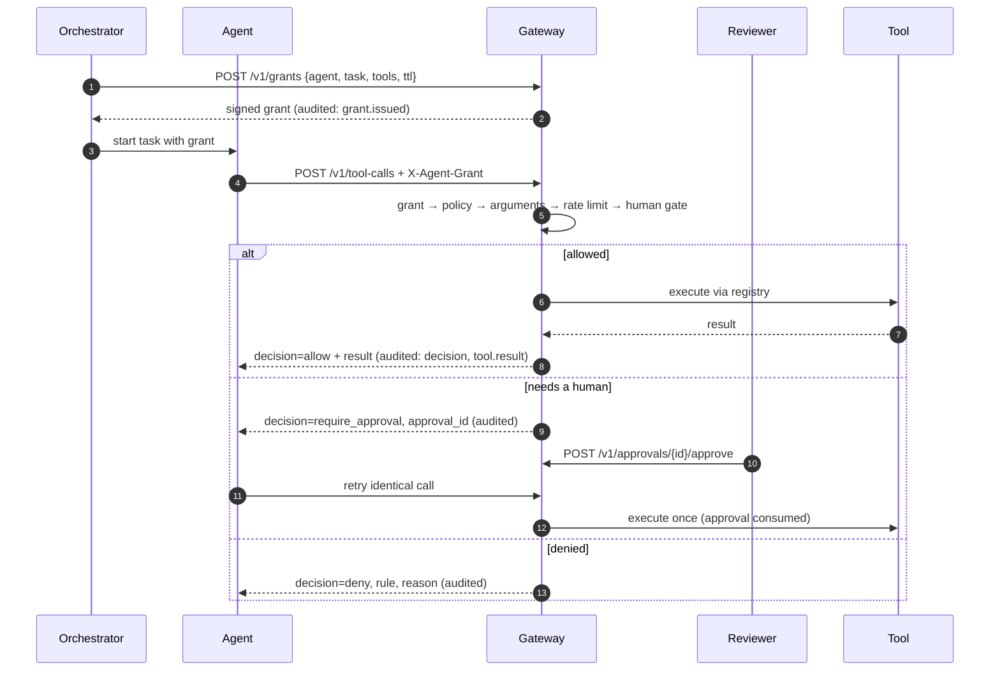

# Architecture

## Where the gateway sits

An agent platform has three parts that matter here: the **model** that decides what to do,
the **orchestrator** that runs tasks, and the **tools** that change things in the world.
The gateway sits between the last two. The model never holds credentials for a tool;
the gateway does, and it only uses them for calls it has approved.

This gives the security team one choke point to reason about, regardless of which model,
framework (LangGraph, Semantic Kernel, CrewAI, custom) or vendor the agent runs on.

## Request lifecycle

## The decision pipeline

Checks run in a fixed order and the first failure decides. Order matters:

1. **Grant** first, because nothing else should be evaluated for an unauthenticated
   caller, and because grant checks are cheap and stateless.
2. **Policy** before arguments, so an agent cannot probe which arguments a forbidden
   tool would accept.
3. **Arguments** before the rate limit, so malformed calls do not consume budget.
4. **Rate limit** before the human gate, so a runaway agent cannot flood reviewers with
   approval requests.
5. **Human gate** last, because it is the only step with a side effect on people.

Every outcome carries a machine-readable `rule` (`grant.tool_out_of_scope`,
`policy.argument_violation`, `human_gate`, …) and a human-readable `reason`. Agents get
the reason back so the model can adjust; dashboards group by rule.

## State

| State | Store | Why |
|---|---|---|
| Grants | none (signed tokens) + revocation set | verify without a lookup; revocation is rare |
| Approvals | SQLite | durable across restarts; queryable by reviewers |
| Audit log | append-only JSONL | trivially shippable to a SIEM; verifiable offline |
| Taint, rate limits | memory | short-lived; move to Redis for multiple replicas |

## MCP proxy

The proxy speaks the MCP stdio transport (newline-delimited JSON-RPC 2.0). It forwards all
traffic unchanged except:

- **`tools/list` responses**: filtered to the intersection of the agent's policy and its
  grant. Hiding tools reduces the chance the model even attempts a forbidden action.
- **`tools/call` requests**: evaluated first. Allowed calls are forwarded; denied calls
  and calls awaiting approval are answered by the proxy itself with `isError: true` and an
  explanation, so the server never sees them.
- **`tools/call` responses**: if the tool is marked `untrusted_output`, the session is
  tainted when the result comes back.

The message logic lives in `McpInterceptor`, which has no I/O, so it is unit-tested
directly. A separate end-to-end test runs the real proxy process against a stub server.
